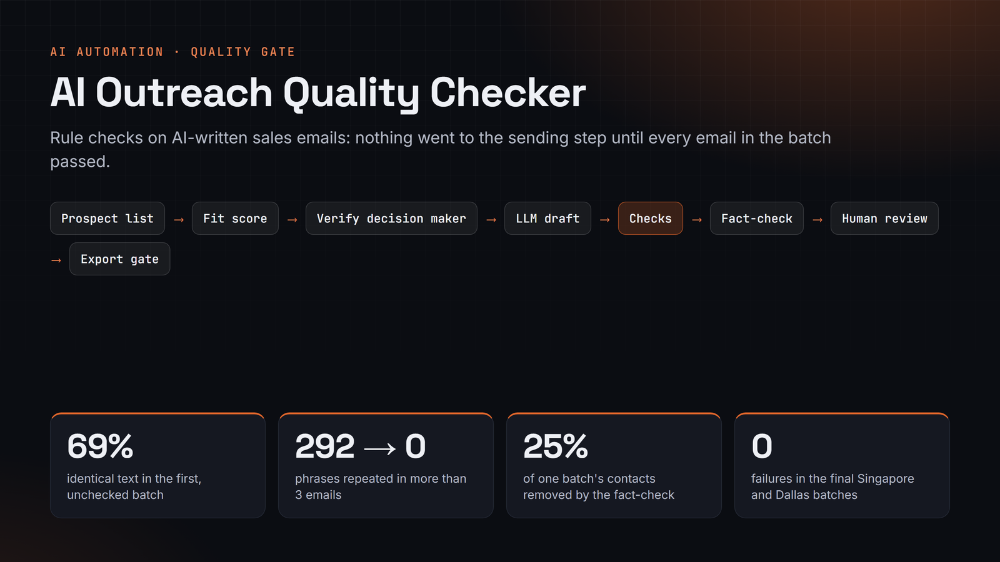

# AI Outreach Quality Checker

Rule checks I wrote for AI-written sales emails in an SME prospecting campaign. An LLM drafted each email; the
checks caught generic, repetitive or unsupported copy, and the export step refused to write a send file until every
email in the batch passed.



## Why it was needed
The first batch was a mail-merge with no checks: 50 emails, 69% identical text, 292 phrases that appeared in more than
3 emails, 8 sentences shared by all 50, and an average of 221 words.

## What is checked
- **Each email:** length band (90-175 words; 30-60 for the personalised paragraph), at most 2 questions, and no
  banned patterns: claims about the reader's security, hints at an incident, unsourced statistics, guarantees,
  stacked asks, stiff openers, long dashes.
- **The whole batch:** no 4-7-word phrase in more than 3 emails, an opening line reused at most 3 times, and every
  subject line unique and at most 62 characters.
- **Against the data:** the greeting uses the contact's first name, the company name appears, the fixed paragraphs
  and signature are unchanged byte for byte, no placeholder is left unfilled, no address is used twice, contacts
  already emailed or excluded are skipped, and US emails contain no Singapore-only terms.
- **Facts:** every company-specific sentence was checked against the company's own website. In the Dallas batches
  this removed 5 of 20 original contacts (25%), then 8 of 26 added contacts, and rewrote 11 paragraphs.

## How it runs
Prospect list → fit score (Dallas: 0-100 from sector 30, funding 35, substance 20, reach 15) → decision maker
verified (current employment must name the company; guessed emails never used) → LLM draft → checks → fact-check →
human review → export gate.
A failed check prints every problem and stops the export. The copy is rewritten and the check runs again. The final
Singapore (50 emails) and Dallas (45) batches passed with 0 failures.

## Try it
[`checker/outreach_check.py`](checker/outreach_check.py) re-implements the rules with the same thresholds (the
original scripts hold campaign data). The sample batch is fictional and has deliberate mistakes:

```
python checker/outreach_check.py checker/sample_batch.json
...
6 emails checked: 4 passed, 2 failed, 3 batch problems
RESULT: NOTHING EXPORTED - fix the copy and run again
```

**Tools:** Python (re, collections, json), LLM drafting, people-search API for contact checks · built with Claude
Code as a coding assistant
